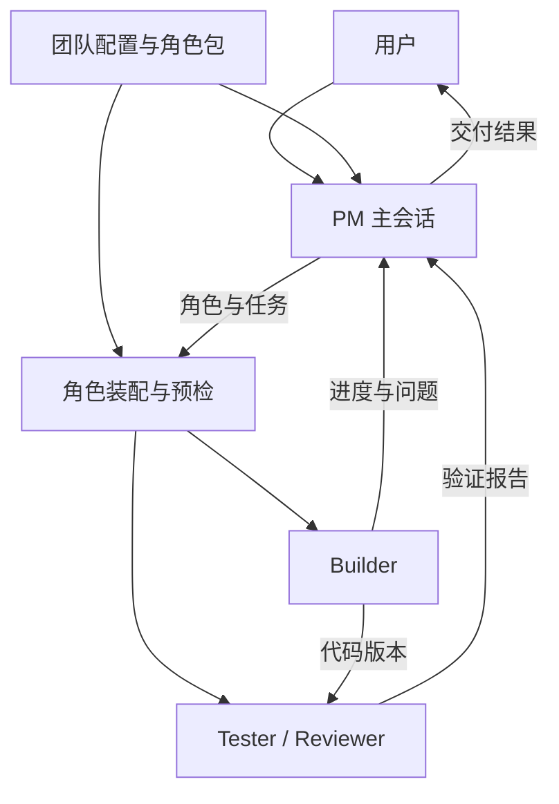

# pi-agent-mesh 可插拔角色 V1 目标与实施计划

日期：2026-10-19  
用途：确认产品目标、实施范围和验收标准。  
配套执行文件：`pi-agent-mesh-codex-plan.md`。  
状态：待实施方案；文中的新配置、命令和能力尚未实现。

## 1. 最终目标

**在项目中启用一份团队配置后，启动 Pi 即进入 PM 主会话。PM 按需创建 Builder、Tester、Reviewer；每个角色独立加载自己的 system prompt、skills、MCP 和本地工具。新增或替换角色只需修改角色包与配置，无须修改调度代码。**

角色是可复用配置。每次派工创建独立任务实例，拥有独立会话与运行状态；工作目录沿用现有共享目录或工作流 worktree 规则。同一个 Builder 角色可以同时承担多个任务。

本期角色功能以 Pi 1.0.2 为最低验证基线。现有无角色的 subagent 调用与历史任务继续保留。

## 2. 完成后的使用方式

1. 在启动目录创建 `.pi/agent-mesh.yaml`，启用团队模式。
2. 直接启动 `pi`，与 PM 讨论需求、约束和验收条件。
3. PM 根据角色目录选择成员，分配任务与必要上下文。
4. Builder 实现；Tester 执行验证；Reviewer 独立检查。
5. PM 收到进度、提问和结果，组织后续工作并向用户交付。
6. 使用现有任务界面查看角色、实际工具、会话、错误和继续操作。



PM 只读取角色目录摘要。其他角色的完整提示词、skills 和服务连接在派工时加载。

## 3. 配置约定

### 团队配置

```yaml
schema_version: 1
enabled: true
main_role: pm

roles:
  pm: builtin:pm
  builder: ./roles/builder/role.yaml
  tester: builtin:tester
  reviewer: builtin:reviewer

mcp_servers: {}
```

团队配置中的角色路径相对于该配置文件；上述 Builder 路径对应 `.pi/roles/builder/role.yaml`。角色只来自这里明确列出的引用；V1 使用显式注册，不增加多目录覆盖规则。

自定义位置通过 `PI_AGENT_MESH_CONFIG` 指定。未启用团队模式时，保留现有使用方式。

### 角色配置

```yaml
schema_version: 1
id: builder
description: 实现功能并修复缺陷
system_prompt: ./system.md

skills:
  - ./skills/coding/SKILL.md

builtin_tools: [read, grep, find, ls, edit, write, bash]

mcp: []

extra_tools:
  - entry: ./tools/test-runner.ts
    tools: [run_tests]

defaults:
  model: inherit
  context: partial
  access: full
```

角色资源路径相对于 `role.yaml`。MCP 通过 `{server: docs, tools: [search, fetch]}` 引用团队配置中的服务。

| 字段 | 明确职责 |
| --- | --- |
| `system_prompt` | 稳定的职责、工作原则和交付要求 |
| `skills` | 工作方法和操作流程；不自动授予工具 |
| `builtin_tools` | 角色可使用的 Pi 内置工具 |
| `mcp` | 角色需要的外部服务及精确工具名单 |
| `extra_tools` | 本地工具型 Pi 扩展及选中的工具 |
| `defaults` | 默认模型、上下文模式和访问模式 |

## 4. 本期必须交付的能力

| 能力 | 完成标准 |
| --- | --- |
| PM 启动模式 | 启用配置后，首次对话已包含 PM 指令和角色目录 |
| 四个内置角色 | PM、Builder、Tester、Reviewer 均有独立角色包 |
| 角色可插拔 | 增删角色引用并成功 reload 后，新任务使用新目录，无须改代码 |
| 独立能力装配 | PM 没有 bash，也能派出配置了 bash 的 Builder |
| Skills 与本地工具 | 实际加载选中的资源；缺失或不兼容时准确报错 |
| MCP | 支持 stdio 与 Streamable HTTP，连接和调用限于选中服务与工具 |
| 可检查与可继续 | 查看有效配置和资源来源；PM 会话恢复、子任务继续均沿用原角色快照 |
| 工作流接入 | DAG 步骤可指定角色及独立上下文，复用现有 worktree 机制 |
| 失败处理 | 预检失败不调用模型；取消和退出不遗留本地 MCP 进程 |

### 四个默认角色

- **PM**：澄清需求、拆解、派工、答复子任务问题、检查结果依据。主会话拥有运行时提供的团队管理工具。
- **Builder**：在指定范围实现，交代改动、验证和未完成事项。默认 `partial + full`。
- **Tester**：运行测试并记录命令、结果、失败位置和复现条件。默认 `partial + full`。
- **Reviewer**：依据需求与代码进行独立审查。默认 `none + read-only`。

`full` 只表示使用该角色声明的全部能力。现有 `read-only` 继续仅保留已验证的读取类内置工具；需要 MCP 的自定义 Reviewer 使用 `full` 加明确、较窄的工具清单。

## 5. 实施顺序

| 阶段 | 交付物 | 通过条件 |
| --- | --- | --- |
| M0 基线与恢复 | 当前基线记录、两处恢复修复、Pi API 最小验证 | 遗留锁可恢复；容量不足不会耗尽恢复预算 |
| M1 配置与目录 | 两种配置 schema、角色解析、内置角色 | 配置正确可解析；错误可定位；列表不启动服务 |
| M2 角色运行 | 独立工具与 skills 装配、角色提示词、两阶段快照 | 角色能力真实生效；预检失败零模型调用 |
| M3 MCP 接入 | 复用 Pi 原生 MCP 的角色适配层 | 两种 transport、工具限制、超时取消和退出通过 |
| M4 PM 与工作流 | PM 入口、角色列表、步骤级角色和上下文 | PM 能组队；不同步骤得到各自的配置 |
| M5 验证与交付 | 回归测试、打包验证、使用文档、演示 | 下方验收清单全部满足 |

M0 的恢复问题来自此前固定版本的审查。若执行时仓库已经修复，保留相应回归验证即可。

## 6. 最终验收清单

- [ ] 启用团队配置后，用户的首次输入交给 PM。
- [ ] PM 通过角色 ID 派出 Builder、Tester、Reviewer。
- [ ] Builder 的写入工具不依赖 PM 是否拥有同一工具。
- [ ] 不同角色的 skills、提示词和实际可调用工具符合各自配置。
- [ ] 自定义角色可以通过增加目录和配置引用接入。
- [ ] 缺失 skill、工具或 MCP 服务时，模型调用次数为零，并显示具体原因。
- [ ] 未选中的本地工具和 MCP 工具不能被直接或间接调用。
- [ ] 修改角色配置后，成功执行 `/roles reload` 或开启新会话，新任务使用新版本；旧任务继续使用原快照，并检查资源变化。
- [ ] 恢复已有 PM 会话时沿用原提示词与能力；PM 自身的配置更新在新会话生效。
- [ ] DAG 中 Reviewer 可使用独立上下文，且不接收 Builder 自评报告。
- [ ] 取消、退出、继续和恢复不破坏现有进程清理规则。
- [ ] 已有无角色调用与历史记录保持兼容。
- [ ] 干净安装后的包包含角色资源、schema 和示例；测试与类型检查通过。

“快照”固定角色配置、提示词和已发现的工具定义。它不承诺冻结远端 MCP 服务实现或所有第三方依赖。

## 7. 后续独立迭代

结构化验收结论、基于代码版本的自动返工轮次、角色市场和跨 Agent MCP 连接池放入后续版本。本期仍由 PM 阅读测试与审查依据组织工作，`completed` 继续表示执行结束。

## 8. 设计依据

- [审查基线 a16abfd](https://github.com/Eryx-Z/pi-agent-mesh/commit/a16abfdda11751d7e518b2b910fd99860085a8d5)：已有 RPC、DAG、worktree、会话持久化和恢复。
- [当前 Loadout](https://github.com/Eryx-Z/pi-agent-mesh/blob/a16abfdda11751d7e518b2b910fd99860085a8d5/pi-extension/subagents/loadout.ts)：现有能力继承与访问过滤边界。
- [Pi MCP 文档](https://github.com/earendil-works/pi/blob/main/packages/coding-agent/docs/mcp.md)：原生服务连接与工具暴露。实施 API 以锁文件安装的 Pi 1.0.2 类型和源码为准。

